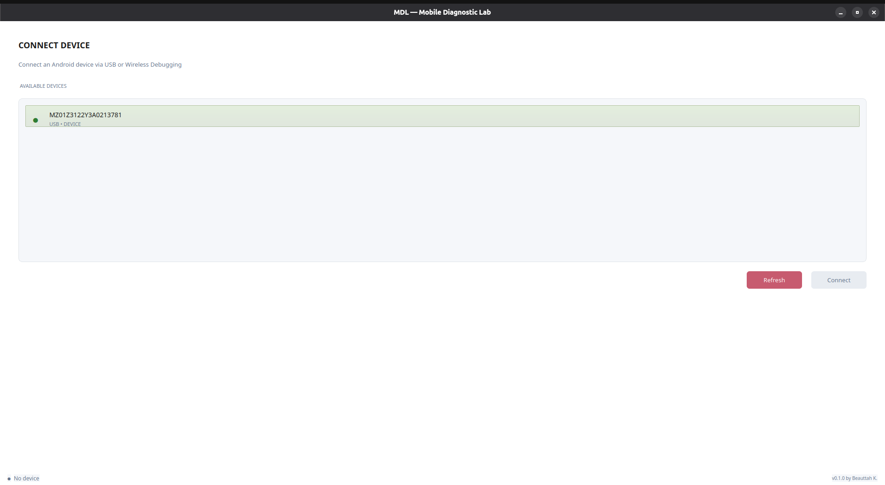
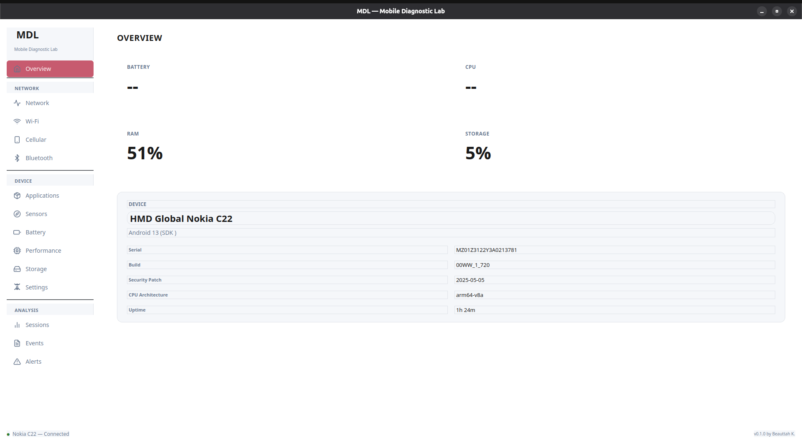

# MDL v0.1 - Mobile Diagnostic Lab 

**Android Monitoring platform**

*Beauttah K.*

MDL connects to Android devices through USB or Wireless Debugging, continuously collects telemetry, and presents it through a  real-time desktop interface.


## Installation Guide

### Requirements

- Python 3.12+
- ADB (Android Debug Bridge)
- Android device with USB debugging enabled
### clone Repository
```bash

git clone https://github.com/kiprutobeauttah/MDL.git

```
### Setup 

```bash
# Install dependencies
pip install -r requirements.txt

# Or use pip with pyproject.toml
pip install -e .
```

### Verify ADB

```bash
# Check ADB is working
adb devices

# Should show your connected device
# --------------------------
# List of devices attached
# XXXXXXXXXX      device
# --------------------------

```

## Launch

```bash
# Launch MDL
python app.py
```
## Android setup
1. Connect your Android device via USB
2. Enable USB debugging
3. Click **Refresh** to detect devices
4. Select your device and click **Connect**
5. Dashboard shows live metrics

## Interface

> > List of devices detected




>> Informative ui



---
_More features to be intergrated later ..._
